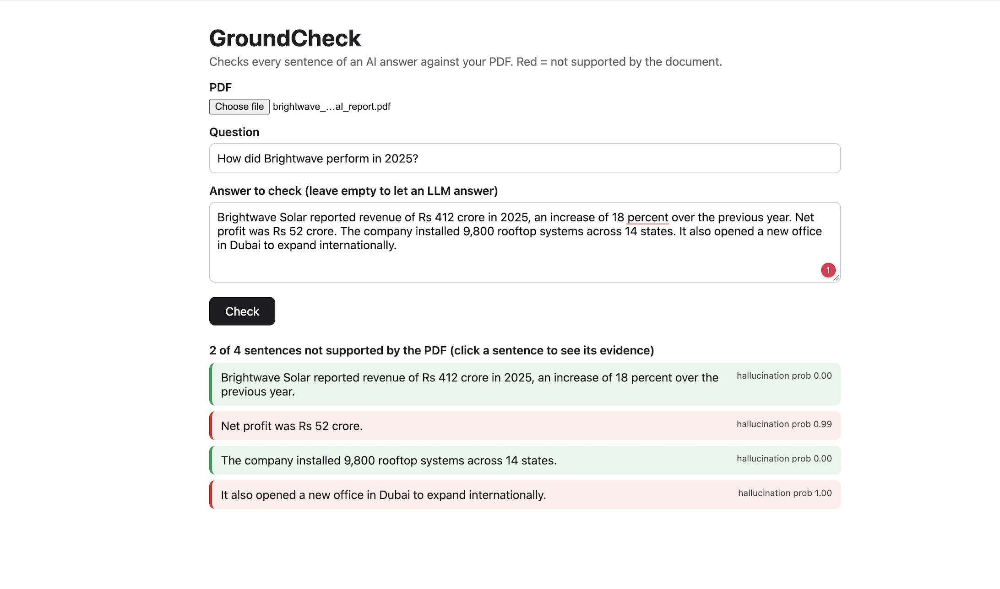

# GroundCheck

Checks an LLM's answer against the document it was supposed to come from, one sentence at a time, and flags the sentences the document doesn't support.

You upload a PDF, ask a question, and paste an answer (or let an LLM write one). Every sentence comes back green (supported) or red (not supported), with the passage from the PDF it was checked against.



## Why

When a chatbot answers from a document, it sometimes adds things that aren't in it: a wrong number, a made-up date, an extra detail that sounds right. These are hallucinations, and they're hard to spot because the rest of the answer is correct.

Two cheap ways to check for them don't work well:

- **Exact match** fails because LLMs rephrase everything.
- **Embedding similarity** fails because "revenue grew 12%" and "revenue fell 12%" look almost identical to it. It measures topic, not truth.

GroundCheck uses natural language inference (NLI) instead: given the evidence, is this sentence actually supported? I fine-tuned a small model to do this on human-labelled LLM hallucinations.

## How it works

1. **Split** the answer into sentences.
2. **Retrieve** the 2 most relevant chunks of the document for each sentence, using `bge-small-en-v1.5` embeddings and cosine similarity.
3. **Judge** each (evidence, sentence) pair with a fine-tuned DeBERTa-v3-base classifier, which outputs the probability that the sentence is not supported.
4. **Flag** sentences above a threshold (0.68, tuned on validation data).

## Data

Training data comes from [RAGTruth](https://github.com/ParticleMedia/RAGTruth): about 18,000 responses from 6 LLMs across QA, summarisation and data-to-text tasks, where human annotators marked the exact hallucinated spans.

The model works on sentences, so I converted the span labels: a sentence is labelled hallucinated if it overlaps any annotated span. That gives:

| Split | Sentences | Hallucinated |
|---|---|---|
| Train | 101,417 | 11.2% |
| Validation | 11,091 | 10.5% |
| Test | 18,977 | 8.3% |

Validation is split by source document, so no article appears in both train and validation.

## Training

- Base model: `MoritzLaurer/DeBERTa-v3-base-mnli-fever-anli` (184M parameters, already trained on general NLI), with its 3-way head replaced by a 2-way head (supported / hallucinated).
- Only about 1 in 9 sentences is hallucinated, so the loss is weighted by class frequency. Otherwise the model learns to say "supported" for everything.
- 2 epochs, learning rate 2e-5, effective batch size 16, max length 512 tokens.
- Best checkpoint chosen by validation PR-AUC.
- Trained on Kaggle (2x T4 GPUs) in about 4.5 hours.

## Results

### RAGTruth test set (sentence level)

| Method | Precision | Recall | F1 | ROC-AUC | PR-AUC |
|---|---|---|---|---|---|
| Embedding similarity | 0.11 | 0.69 | 0.19 | 0.63 | 0.12 |
| DeBERTa NLI, no fine-tuning | 0.17 | 0.64 | 0.27 | 0.73 | 0.17 |
| **GroundCheck (fine-tuned)** | **0.61** | **0.63** | **0.62** | **0.91** | **0.65** |

Each method's threshold was tuned on the validation set. Since only 8% of test sentences are hallucinated, a random guesser would get a PR-AUC of about 0.08.

Fine-tuning more than doubled F1 over the same model used zero-shot, so general NLI knowledge alone isn't enough to catch LLM-style hallucinations.

### Response level

If a response counts as hallucinated when any of its sentences is:

| Precision | Recall | F1 | ROC-AUC |
|---|---|---|---|
| 0.75 | 0.75 | 0.75 | 0.89 |

### By task

| Task | F1 | ROC-AUC |
|---|---|---|
| Data-to-text | 0.70 | 0.94 |
| QA | 0.56 | 0.88 |
| Summarisation | 0.33 | 0.85 |

### Out of domain: HaluBench

2,000 random examples from [HaluBench](https://huggingface.co/datasets/PatronusAI/HaluBench), which the model never saw during training. It includes medical, finance and reading-comprehension data.

| Precision | Recall | F1 | ROC-AUC |
|---|---|---|---|
| 0.85 | 0.49 | 0.62 | 0.79 |

| Source | ROC-AUC |
|---|---|
| CovidQA | 0.86 |
| HaluEval | 0.82 |
| PubMedQA | 0.72 |
| FinanceBench | 0.57 |
| DROP | 0.53 |

## Limitations

- **Arithmetic.** It can't verify numbers that need calculating. If the document says profit was 37 and revenue 412, it won't confirm "the margin was 9%". This is why it's close to random on DROP and FinanceBench.
- **Summaries.** A summary sentence often combines facts from several parts of a document. With only the top 2 chunks as evidence, correct sentences sometimes get flagged.
- **Threshold transfer.** The 0.68 threshold was tuned on RAGTruth, where hallucinations are rare. On HaluBench (half hallucinated), it's too cautious, giving high precision but missing half the cases.
- **English only**, and scanned PDFs without a text layer aren't supported.

## What's next

- Send numeric or uncertain sentences to a larger LLM judge, and keep the small model for everything else (a cascade), then measure the cost vs accuracy trade-off.
- Retrieve more evidence for long documents and summaries.
- Export to ONNX and quantize for faster CPU inference.
- Scan uploaded PDFs for prompt-injection text before they reach the LLM.

## Run it

Requires Python 3.11.

```bash
git clone https://github.com/gellajayaramakrishna/groundcheck.git
cd groundcheck
python3.11 -m venv .venv
source .venv/bin/activate
pip install -r requirements.txt
python -m pytest -q
```

Start the app:

```bash
python -m uvicorn app.main:app --reload
```

Open http://127.0.0.1:8000. Without a trained model in `models/groundcheck`, it falls back to the zero-shot NLI model. To have an LLM write answers, set a free [Groq](https://console.groq.com) key first:

```bash
export GROQ_API_KEY="your_key"
```

### Reproduce training

```bash
git clone --depth 1 https://github.com/ParticleMedia/RAGTruth.git data/raw/RAGTruth
python -m src.prepare_data
python -m src.train --batch_size 8      # on a GPU
python -m src.evaluate
python -m src.baselines
```

## Project structure

```
src/
  text_utils.py     sentence splitting with character offsets, chunking
  retriever.py      embedding retrieval (step 1)
  prepare_data.py   RAGTruth spans -> sentence-level training pairs
  train.py          fine-tuning with class-weighted loss
  checker.py        NLI scoring and the full pipeline (step 2)
  evaluate.py       test, per-task, response-level and HaluBench evaluation
  baselines.py      similarity and zero-shot NLI baselines
  metrics.py        imbalanced-class metrics and threshold tuning
app/
  main.py           FastAPI backend
  static/index.html web UI
tests/              unit tests
results/            eval.json, baselines.json
```

## References

- Niu et al., *RAGTruth: A Hallucination Corpus for Developing Trustworthy Retrieval-Augmented Language Models*, ACL 2024
- Ravi et al., *Lynx: An Open Source Hallucination Evaluation Model* (HaluBench), 2024
- He et al., *DeBERTaV3: Improving DeBERTa using ELECTRA-Style Pre-Training*, 2021
